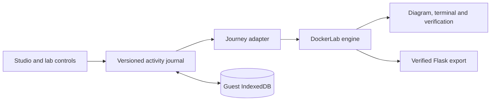

# JIJO learning studio

## Product and release scope

The first journey teaches a learner to distinguish a running process, a container listener, and a published host port. An initial Flask case has no mapping. A second service already publishes a port but forwards to the wrong listener. A prediction, two observed HTTP paths and an explanation provide evidence of learning. The resulting project can be taken out of the browser and examined or run locally.

## Existing project audit and integration

The pre-implementation audit built all five apps using their installed dependencies. Its historical results give the starting point for integration.

| Project | Evidence from that audit | Integration decision |
| --- | --- | --- |
| DockerLab | 61 engine tests and 11 browser tests passed | Direct source imports for the Docker, Dockerfile and Compose engines. JIJO owns its activity state. |
| Raga Git | 133 logic tests and 13 selected browser tests passed | Adapted the prediction-before-execution and evidence-based progress patterns. Git history modeling remains a separate domain. |
| NetVerse | 96 logic tests and 17 selected browser tests passed | Retain the packet and AWS topology models for a later networking exercise. |
| TerraForge | 31 logic tests and 14 browser checks passed | Defer HCL integration until parser assets, dependency pinning and clean installation have been verified. |
| BroCode Paradise | 719 indexed topics and 45 desktop browser tests passed | Field notes reference the Linux guide’s networking and cURL entries. JIJO authors its Docker cases and assessments. |

The original audit found different routing, storage schemas and CSS across apps, missing Terraform WASM assets, and development-tool advisories in legacy lockfiles. Its results covered selected browser suites and were not a fresh installation of every legacy application. The root repository checkpoint is d0f89ef. Preserve provenance and review reuse rights before redistributing additional material.

## Architecture decisions

1. Ship one static React and TypeScript application with Vite. The root install resolves all JIJO dependencies. The DockerLab engine import is source-level, so deployment must build from the repository root. The legacy applications remain separate entry points.
2. Keep domain behavior in dockerlab/src/engine/. The journey adapter supplies fixtures, a limited command grammar and acceptance rules. A configuration repair recreates the service through engine operations. Learners can issue their own supported lifecycle commands. Both paths verify a request against the resulting state.
3. Store a versioned action journal in IndexedDB. A guest project contains the schema version, journey ID and up to 512 actions. Replay reconstructs the lab, answers, attempted repairs and completion. The saved revision is checked in the same transaction as each write. Concurrent edits surface a reload message. UI navigation and unsubmitted form text are transient.
4. Build exports in a lazy-loaded module. Generate the Dockerfile and Python source from the same fixture as the simulation. Derive the Compose mapping from the verified container. Parse and simulate that Compose stack in a fresh engine and require a successful HTTP probe before offering its ZIP.
5. Keep the application static for the first journey. The browser handles guest storage, validation and downloads. A future real-lab service would require a separate authenticated control plane, bounded execution, cleanup and cost limits.

## Verification

The two playgrounds share a separate versioned IndexedDB record for the graph, framework drafts and node positions. Service-to-service edges specify startup dependencies, service-to-network edges attach endpoints, and service-to-volume edges specify mount paths. The inspector provides the same connection operations as the canvas. A dependency representing communication must share a network with its target.

The graph compiler checks names, published-port conflicts, mount paths, network membership and dependency cycles. It passes the generated YAML and its explicit set of build directories to DockerLab’s Compose parser. The ZIP contains the exact Dockerfile snapshot attached to each application. PostgreSQL uses a required environment variable for its password. These samples illustrate configuration; application-level database clients and readiness checks require additional code.

The Dockerfile editor checks a single-stage subset against its supplied context. The Node lessons compare the manifest and lockfile before modeling npm ci. The Python lessons check the requirements file. The result includes step feedback, entry-point file and command checks, and the exercise's expected EXPOSE metadata. The Compose CLI export check also resolves the full four-framework fixture and compiles or syntax-checks its entry points.

Use the root README commands. Unit checks cover missing, wrong and UDP bindings, stopped containers, alternative command sequences, gated progression, unsupported commands, malformed backups and ZIP contents. The production-build browser suite covers end-to-end repair, mobile navigation, download, import, storage loss and competing tabs. Run DockerLab’s own npm test from dockerlab/ to check its original callers.

The standalone export check runs docker compose config and Python bytecode compilation on generated files in a temporary directory. The browser models supported Dockerfile and Compose instructions. Installing Flask, building a real image, HTTP testing against a real container and production release verification are separate operations.

## Release and recovery

1. Install from the root lockfile, run the checks and review the production build in dist/. The GitHub Actions workflow performs these checks on pushes and pull requests.
2. For a reviewed Vercel preview, use the repository root, Vite preset, npm ci, npm run build, and dist/ as output. The current hash routes work from static hosting. The first journey requires no secrets or backend. Keep production promotion manual.
3. Test prediction, repair, transfer, export and restore against the preview. After explicit approval, promote the reviewed build. Roll back to the prior known-good deployment through the hosting provider. Preserve the journal version when rolling forward or back.
4. Progress belongs to the browser origin. Use Project files to save a backup before changing origins or clearing site data. Imported JSON is size-limited, schema-checked and replayed before replacement. A corrupt record requires explicit replacement. Storage-denied sessions can still export a backup.

## Security, limitations and roadmap

Supported terminal input is tokenized, validated and interpreted in browser memory. Commands never reach a host shell or remote service. Imported text is rendered through React. There are no accounts, analytics, database credentials or paid infrastructure dependencies in this increment. Local journals can be edited by their owners and are suitable for practice feedback.

The engine covers one TCP/HTTP service per exercise. Startup, listening ports, network forwarding and the response are modeled. DNS failures across machines, real image pulls and host firewall behavior are outside this journey. The ZIP uses Flask’s development server for local learning. Real hardware, cross-browser behavior beyond the tested Chromium environment, and production deployment require separate verification.

After learner feedback, add a bounded second journey with its own domain adapter and content version. Candidate topics are Git history repair or packet reachability. Accounts, cross-device sync, Terraform import and hosted real labs need separate scope and acceptance criteria.
