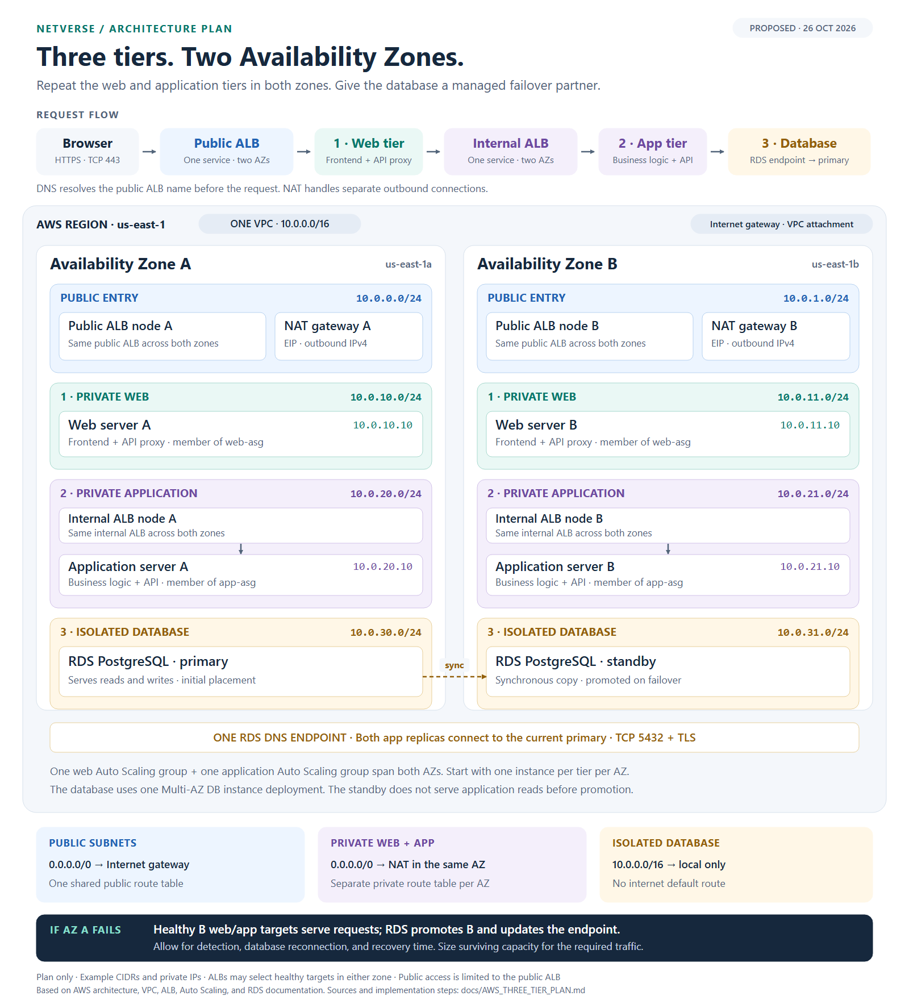

# AWS three-tier architecture plan

Status: editable node graph implemented, 27 October 2026. Open **AWS VPC builder** in NetVerse, or follow `/#aws-architecture`. The architecture uses the same node canvas, inspector, dragging, connections, fullscreen, and project persistence as the other labs. It has request, routing/NAT, and Auto Scaling views. ALB requests, scaling actions, and database failover remain future simulation extensions. The printable reference below is supplemental; the website's main architecture is the node graph. No real AWS resources are created.

[Open the architecture chart (SVG)](assets/aws-three-tier-architecture.svg) · [PNG](assets/aws-three-tier-architecture.png) · [Printable PDF](assets/aws-three-tier-architecture.pdf)

## Intended behavior

Run a classic web application across two selected Availability Zones in one AWS Region. Both zones run the same web and application code. The database uses an Amazon RDS PostgreSQL Multi-AZ DB instance deployment with one primary and one synchronous standby. An AZ outage leaves a serving web/application path in the surviving zone, subject to available capacity and database failover recovery.

The three application tiers are web/presentation, application/business logic, and database/storage. Public load-balancer and NAT subnets support those tiers. Three tiers does not prescribe a number of subnets. Every subnet belongs to one AZ and has its own non-overlapping CIDR. Public/private describes routing, not the zone. This follows the topology in [AWS's classic web application reference architecture](https://d1.awsstatic.com/architecture-diagrams/ArchitectureDiagrams/web-application-architecture-on-aws-ra.pdf) and [AWS subnet guidance](https://docs.aws.amazon.com/vpc/latest/userguide/configure-subnets.html).

## Concrete network layout

Use `us-east-1` to match the current learning template. `us-east-1a` and `us-east-1b` are example account-specific AZ names; choose two available zones when deploying. VPC: `10.0.0.0/16`, IPv4, DNS support enabled. Region and instance sizes are deployment choices, not requirements of three-tier architecture.

| Purpose | AZ A | AZ B | Contents |
| --- | --- | --- | --- |
| Public entry | `10.0.0.0/24` | `10.0.1.0/24` | Nodes of one internet-facing ALB; one zonal public NAT gateway and EIP per AZ |
| Tier 1: private web | `10.0.10.0/24` | `10.0.11.0/24` | Web/frontend servers, one web Auto Scaling group spanning both subnets |
| Tier 2: private application | `10.0.20.0/24` | `10.0.21.0/24` | Application/API servers; nodes of one internal ALB; one application Auto Scaling group spanning both subnets |
| Tier 3: isolated database | `10.0.30.0/24` | `10.0.31.0/24` | RDS primary initially in A, synchronous standby initially in B; one DB subnet group |

All EC2 instances and RDS instances have no public IP/access. Web and application workloads are stateless: deploy the same version to both zones, use signed tokens or shared durable session state, and avoid keeping required user state only on instance disks.

There are two ALBs total, not one independent ALB per AZ per tier. Each ALB has an attachment in each of its two selected subnets. An ALB deployed in ordinary regional AZs requires subnets in at least two different AZs. [AWS ALB subnet requirements](https://docs.aws.amazon.com/elasticloadbalancing/latest/application/application-load-balancers.html)

## Request path

1. The browser resolves the application's domain through DNS. Route 53 may supply an alias to the public ALB. DNS resolution is not a proxy hop for HTTP traffic.
2. The browser sends HTTPS on TCP 443 to the internet-facing ALB, through the VPC's internet gateway. Use an ACM certificate for the public listener.
3. The public ALB selects a healthy web target in either AZ. The web tier serves frontend content and proxies API requests to the internal ALB.
4. The internal ALB selects a healthy application target in either AZ. Application code performs business logic and accesses the database.
5. Both application replicas connect to the same RDS DNS endpoint on TCP 5432 using TLS. That endpoint resolves to the current primary; ordinary application traffic does not go to the standby.
6. Responses return over the established connections. ALBs terminate and originate connections, so the complete request is multiple connections rather than one unchanged packet passing through every tier.

Proposed example ports: browser to public ALB 443; public ALB to web targets 8080; web to internal ALB 443; internal ALB to application targets 8080; application to PostgreSQL 5432 with TLS. The internal ALB listener needs a certificate trusted by the web clients. The 8080 target hops are private HTTP in this teaching baseline; use HTTPS targets when end-to-end transport encryption is required. `/healthz` uses the target traffic port; define lightweight application-aware health checks.

Cross-zone target routing is enabled for both ALBs and their target groups. Target health, security rules, and AZ status determine eligible targets; subnet symmetry by itself does not provide failover.

## Routing and outbound access

| Route table | Associated subnets | Routes in this IPv4 baseline |
| --- | --- | --- |
| `rt-public` | Public A and B | `10.0.0.0/16 → local`; `0.0.0.0/0 → igw` |
| `rt-private-a` | Web A and app A | `10.0.0.0/16 → local`; `0.0.0.0/0 → nat-a` |
| `rt-private-b` | Web B and app B | `10.0.0.0/16 → local`; `0.0.0.0/0 → nat-b` |
| `rt-db` | DB A and B | `10.0.0.0/16 → local`; no internet default route |

The internet gateway is attached to the VPC. Route tables and security groups are VPC resources, not appliances living in subnets. NAT A and B are zonal public gateways in their respective public subnets, each with an EIP. They serve outbound connections initiated by private web/application servers, such as updates and external API calls. They are not on the inbound ALB request path or the private web-to-app/database path.

This plan deliberately selects the zonal NAT design: a server uses its own AZ's NAT so loss of the other AZ does not remove its outbound path. VPC endpoints can replace NAT use for supported AWS service traffic. [AWS NAT resiliency guidance](https://docs.aws.amazon.com/vpc/latest/userguide/nat-gateway-basics.html), [AWS production VPC example](https://docs.aws.amazon.com/vpc/latest/userguide/vpc-example-private-subnets-nat.html)

## Security boundaries

Use security-group references between tiers. The following are application-path rules; operational access, outbound API destinations, and endpoint rules must be added explicitly as required. Security groups are stateful, so allowed connection responses do not need independent ephemeral-port allow rules. Keep baseline NACLs permissive while learning these boundaries; a restricted NACL design must cover both directions, health checks, and ephemeral ports.

| Security group | Allowed inbound | Application-path outbound |
| --- | --- | --- |
| `sg-public-alb` | TCP 443 from `0.0.0.0/0` | TCP 8080 to `sg-web`, including health checks |
| `sg-web` | TCP 8080 from `sg-public-alb` | TCP 443 to `sg-internal-alb` |
| `sg-internal-alb` | TCP 443 from `sg-web` | TCP 8080 to `sg-app`, including health checks |
| `sg-app` | TCP 8080 from `sg-internal-alb` | TCP 5432 to `sg-db` |
| `sg-db` | TCP 5432 from `sg-app` | No application-initiated outbound connection required; RDS manages replication |

The web tier cannot directly access the database. The public ALB cannot directly access the application or database tiers. Public SSH and direct public server access are not part of the plan. Use Systems Manager with an appropriate instance role and HTTPS connectivity for administration. For a deployment, use managed credentials/secrets, encryption at rest, and automated database backups with restore testing. WAF and CloudFront are optional additions after this baseline is understood.

ALB target security groups must allow both forwarded traffic and health checks from their ALB's security group. [AWS ALB security-group recommendations](https://docs.aws.amazon.com/elasticloadbalancing/latest/application/load-balancer-update-security-groups.html)

## Replication, capacity, and failure behavior

- **Web tier:** one Auto Scaling group across web A and B. Initial teaching configuration: minimum 2, desired 2, maximum 4; normally one instance in each AZ.
- **Application tier:** a separate Auto Scaling group across app A and B with the same initial teaching counts. Instance sizing, maximums, and scaling thresholds require load testing for a real workload.
- **Capacity:** two instances alone do not guarantee survival at peak load. Each surviving zone needs enough existing capacity for the required workload, or the design must tolerate scale-out delay. Do not promise uninterrupted operation solely because Auto Scaling is enabled. [AWS multi-AZ Auto Scaling guidance](https://docs.aws.amazon.com/autoscaling/ec2/userguide/as-add-az-console.html)
- **Database:** use the RDS Multi-AZ DB **instance** option, not a Multi-AZ DB cluster or two independent databases. The standby receives synchronous replication and does not serve application reads. Read replicas are a separate scaling choice. [AWS single-standby RDS deployment](https://docs.aws.amazon.com/AmazonRDS/latest/UserGuide/Concepts.MultiAZSingleStandby.html)
- **AZ A outage:** healthy B web/app targets serve requests; RDS promotes the B standby and updates the DB endpoint's DNS destination. Clients must reconnect with bounded retries and appropriate DNS handling. Failover introduces a recovery interval; it is not zero downtime. [AWS RDS failover behavior](https://docs.aws.amazon.com/AmazonRDS/latest/UserGuide/Concepts.MultiAZ.Failover.html)
- **AZ B outage:** healthy A targets continue serving and the primary in A remains available. Database redundancy is degraded until a standby is restored.
- **NAT A outage:** internet-bound connections originating from private servers in A are affected. B's outbound path remains available. Private application traffic can continue if it does not depend on an external API.
- **Instance failure:** ALB health checks remove the unhealthy target; Auto Scaling replaces the instance. Recovery depends on health-check and launch timings.
- **Region outage:** this two-AZ design does not provide multi-Region disaster recovery. Define recovery objectives and backup/restore arrangements separately for a real deployment.

## Implementation plan for the website

The AWS builder now opens the three-tier node graph; the original basic public/private routing template remains available for packet exercises. `src/engine/types.ts` includes typed ALB, RDS, Auto Scaling, and DNS endpoint resources, database roles, shared service IDs, and logical link categories. The inspector, persistence, and component library support them. Runtime target-group health, scaling policies, RDS promotion, and security-group references remain future engine work; graph links do not claim to perform those actions.

| Step | Work | Completion condition |
| --- | --- | --- |
| 1. Architecture view — implemented | **AWS VPC builder** now displays the editable three-tier node graph using the existing canvas and inspector. It supports dragging, logical connections, zoom, focus, fullscreen, saving, import/export, and undo. Separate connection views keep request, routing, and scaling relationships readable. | Users can identify both copies of each compute tier, public/private boundaries, and the primary/standby difference. |
| 2. Resource model | Add typed ALB and target-group configuration, ASG membership, RDS primary/standby roles, a stable DB endpoint, AZ health, and security-group rule references. Update validation, import/export, migrations, resource library, and inspectors. Model shared ALBs/ASGs at VPC scope with per-subnet attachments. | Old saved topologies load; invalid cross-VPC references and overlapping subnet CIDRs are rejected. |
| 3. Template and request engine | Create the eight subnets, four route tables, two NAT gateways, two ALBs, two ASGs, and one RDS deployment. Add a request simulation that composes load-balanced web, application, and DB connections and evaluates security/health at each hop. | A request succeeds through either healthy compute replica and reaches only the current database primary. |
| 4. Failure experiments | Add controls for failing an instance, NAT gateway, or entire AZ; model health detection, target removal, replacement capacity, and RDS promotion as explicit timed states. Show the recovery interval and explain any interruption. | AZ A failure changes the serving path and DB role; AZ B failure leaves the original primary; a NAT-only failure has the narrower expected effect. |
| 5. Guided learning and validation | Explain routing, SG references, health checks, same-AZ egress, and DB failover. Support fit/fullscreen, readable text, keyboard navigation, saved projects, and undo for edits. | Engine and browser checks cover the scenarios below; a reviewer can follow the request and failure charts without confusing an AZ with a tier. |

## Acceptance scenarios

1. Both AZs contain public, private web, private application, and isolated database subnets; all eight ranges fit the VPC and are non-overlapping.
2. Both ALBs span two AZs; both ASGs reference their two appropriate private subnets. The chart shows single shared services with per-AZ attachments.
3. A browser reaches the web frontend and an API request reaches the database through the permitted tier sequence. Direct browser-to-app/DB and web-to-DB connections fail.
4. Each web/app subnet uses the same-zone NAT for internet-bound traffic. Database subnets have no internet default route. All tier-to-tier connections use private addressing.
5. Failing a web/app instance removes it from eligible targets. Failing AZ A removes all its resources from serving eligibility and triggers primary-to-standby DB promotion.
6. Application traffic never targets the standby before promotion; the same DB endpoint identifies the new primary afterwards. Existing connections can fail and must reconnect.
7. Failing NAT A does not itself disable B's internet egress or local VPC routes. A workload that needs an external API reports that dependency accurately.
8. The diagram remains readable at desktop and mobile sizes through fit, zoom, or scrolling. Labels, legend, and failure states do not rely on color alone.

The design is based on the AWS primary sources linked beside the relevant decisions. CIDRs, ports, server counts, and the website implementation sequence are proposed choices for this project, not universal AWS requirements.
